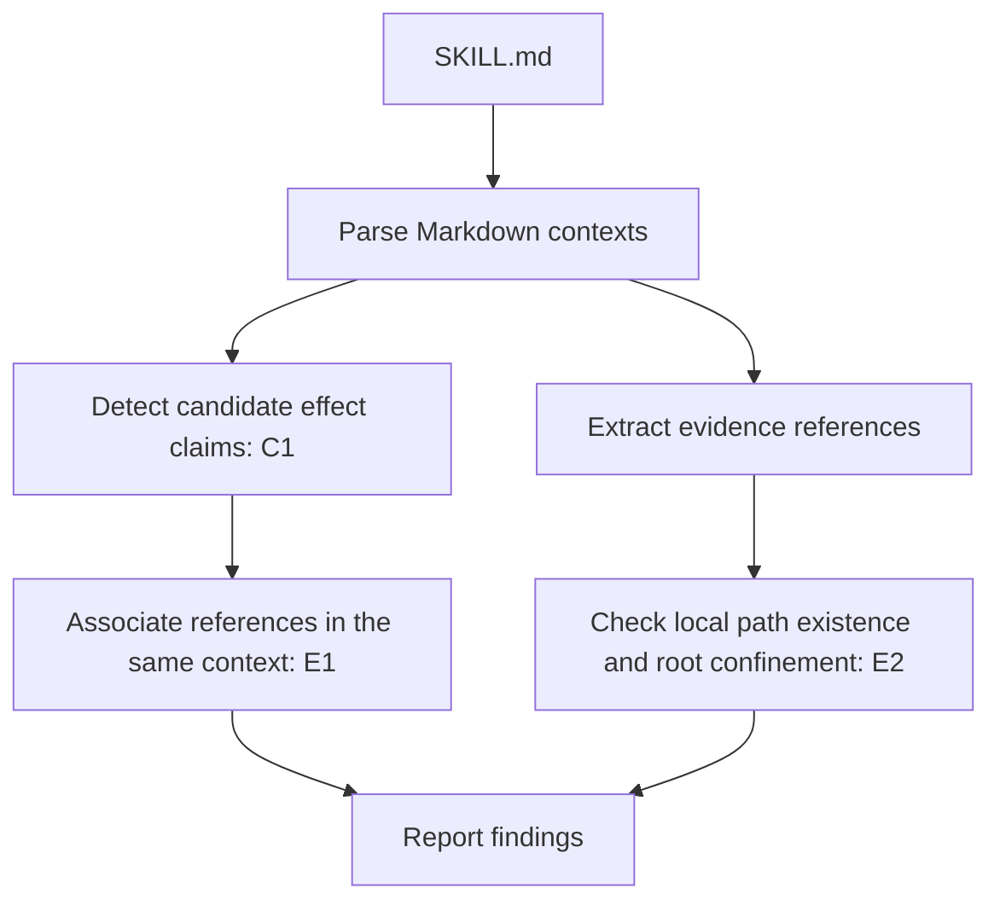

# skill-evidence-lint

[](https://github.com/xiaohei52056/skill-evidence-lint/actions/workflows/tests.yml)
[](https://www.python.org/)
[](LICENSE)

**Check whether an AI Skill's measurable effect claims have a nearby evidence reference — before you publish, install, or review it.**

`skill-evidence-lint` is a lightweight, static linter for the `SKILL.md` files used by AI agents. It detects a conservative set of English effect claims, checks whether each claim has a recognizable evidence reference in the same Markdown context, and checks the safety and existence of detected local paths.

It checks the *presence and placement of references*, not whether a claim is true or whether a reference actually proves it.

## The problem it solves

AI Skills sometimes make statements such as:

- “Reduces processing time by 40%.”
- “Achieves 92% accuracy.”
- “Runs 2x faster.”
- “Zero downtime.”

These claims sound measurable, but a reader may not know where the supporting material is referenced—or whether a referenced local file exists. A general structure linter and a runtime test suite answer different questions; neither automatically ensures that each detectable effect claim in `SKILL.md` has a clearly associated evidence reference.

`skill-evidence-lint` adds a small, focused check for that documentation gap. It helps authors and maintainers notice claims that need a reference before those claims are published or reviewed.

> **Important:** a detected URL or local path is only a reference. This tool does not verify the claim's truth, inspect evidence contents, or determine whether the evidence is sufficient.

## Who is it for?

| User | When to use it | How it helps |
|---|---|---|
| **Skill authors** | Before publishing a Skill: “I wrote that this improves X. Did I include a reference? Does the local path exist?” | Run the linter locally and review C1/E1/E2 output before publishing. |
| **Skill users and maintainers** | Before adopting or updating a downloaded Skill: “Do its detectable effect claims point to something I can locate?” | Run it against the downloaded Skill directory. This is a reference-coverage check, **not** a security audit or proof that the claims are true. |
| **CI / PR maintainers** | When reviewing changes to `SKILL.md` and wanting a lightweight, non-blocking signal. | Add the CLI to an existing CI workflow. In v0.1.0, findings are report-only and do not fail the command. A dedicated GitHub Action and native PR annotations are not yet provided. |

## Where it fits in the Agent Skills toolchain

Different tools answer different questions. `skill-evidence-lint` is designed to complement—not replace—Skill linting, runtime testing, or performance evaluation.

| Tool | Main question it helps answer | Typical approach |
|---|---|---|
| [skill-tools](https://github.com/skill-tools/skill-tools) | Is a Skill well-formed, does it follow expected conventions, and how does it score against its quality checks? | Static validation, lint rules, quality scoring, and routing utilities. |
| [Google's `skills_lint.dart` repository](https://github.com/google/skills_lint.dart) | Does a Skill meet documented specification and directory requirements? | Static checks for items such as `SKILL.md`, frontmatter, directory layout, and relative paths. The repository notes that it is not an officially supported Google product. |
| [SkillTest](https://github.com/JiyangZhang/skilltest) | Does a Skill produce the expected behavior or artifacts when an agent runs test cases? | Test cases, agent execution, and assertions against outputs. |
| [SkillSeal](https://github.com/skillseal/skillseal) | Does a Skill pass structural, functional, and security checks in an isolated environment? | Static checks plus sandboxed functional tests and runtime observations; it can produce verifiable certification evidence. |
| [NVIDIA SkillEvaluator](https://github.com/NVIDIA/SkillEvaluator) | Does a Skill meet quality gates, overlap with existing Skills, or affect agent task results? | A multi-tier workflow spanning validation, deduplication, and live evaluation. |
| [SkillProof](https://github.com/Dafenxz0/skillproof) | Does a Skill improve real task outcomes, and what are the quality, latency, and cost trade-offs? | Controlled benchmark runs and comparisons. |
| **`skill-evidence-lint`** | Do detectable effect claims have a recognizable evidence reference in their local Markdown context? | Static claim detection, strict in-context reference association, and local-path checks. |

These categories overlap in the broader goal of improving Skill quality, but they are not interchangeable. For example, a behavior test may show that a Skill works on a test case; a structure linter may show that its files are valid. `skill-evidence-lint` asks a narrower documentation question: **when a detectable effect claim is written down, is a reference placed where a reader would expect to find it?**

A practical workflow may use more than one layer:

1. Validate the Skill's structure with a specification or quality linter.
2. Check effect-claim reference coverage with `skill-evidence-lint`.
3. Use runtime tests or benchmarks when you need to measure actual behavior or performance.

### Why use this focused check?

- **It checks a different layer.** It focuses on whether measurable effect claims have locally associated references, rather than judging overall Skill quality or executing test cases.
- **The association rule is explicit.** A URL or local path must appear in the same paragraph or enclosing list item. The tool does not guess from nearby sections.
- **No Agent run or API key is needed.** The check is static and uses conservative text patterns; it does not call an LLM.
- **It works offline.** URLs are not fetched and local evidence contents are not opened.
- **It is report-only by default.** E1/E2 findings do not fail the command, making the current CLI suitable for advisory CI checks.
- **It makes boundaries clear.** A reference can be present and still be irrelevant, inaccurate, or insufficient; this linter does not certify otherwise.

## What it checks

The current pipeline has one candidate-claim detection stage and three finding rules (E1, E2, E3).

| Rule | Purpose | Example |
|---|---|---|
| **C1 — Candidate effect claims** | Detects a conservative set of English quantitative or zero-related effect claims. C1 is the claim-detection stage, not a verdict that a claim is true. | `Reduces processing time by 40%.` |
| **E1 — Missing in-context reference** | Reports a detected claim when no recognized URL or local path appears in the same paragraph or enclosing list item. A backtick command example does not clear E1. | A claim in one paragraph and a link only in the next paragraph. |
| **E2 — Local-path problem** | Reports detected local paths that do not exist, resolve outside the Skill root, or cannot be resolved safely. | A missing `references/benchmark.md` or a symlink that points outside the Skill directory. |
| **E3 — Missing reproducibility cue** | Reports a numeric claim when neither its own paragraph/list item nor a directly adjacent fenced command block contains any of: an allowlisted command with a positional argument (`python benchmark.py`, `npm test`, `cargo bench`, …), an input/dataset/config phrase (`on dataset X`, `using configuration Y`), or a metric-definition phrase (`measured as …`, `pass rate`, `accuracy on …`). Environment-only commands such as `python --version` do not count. | A bare "cuts latency by 40%" with no command, dataset, or metric phrase nearby. |

E3's "verifiable" label means only that a recognizable textual cue was found — it does not mean a benchmark ran, that the evidence is authentic, or that the result is actually reproducible.

### Which claims can C1 detect?

C1 currently uses four conservative pattern families:

- **Effect verb + `by` + number/unit:** “reduces processing time by 40%”
- **Achievement verb + number/unit:** “achieves 92% accuracy”
- **Number/unit + comparative:** “2x faster”, “30% less memory”
- **Zero-related phrasing:** “zero downtime”, “near-zero latency”

Negated and some hypothetical claims are filtered. The detector is intentionally limited: it is not a general natural-language understanding system and does not detect every possible effect claim.

### How evidence association works

A reference counts for E1 only when it appears in the claim's **own paragraph or enclosing list item**. A nearby paragraph, a shared heading, or a distant “Evidence” section is not enough. This conservative rule makes the association explicit instead of guessing which reference is intended for which claim.

Recognized URLs are not fetched. Local paths are checked for existence and confinement to the Skill root, but the referenced files are not opened or read.

## How it works



The tool reads `SKILL.md`, parses Markdown contexts, extracts candidates and references, checks association and local paths, then prints a deterministic report. It does not run the Skill, a shell command, an evidence script, or an Agent.

## Example: place the reference with the claim

### Missing reference

```markdown
## Performance

Reduces processing time by 40%.
```

If C1 detects the sentence, it can produce an **E1** finding because no recognized reference appears in that paragraph or its enclosing list item.

### Reference in the same paragraph

```markdown
## Performance

Reduces processing time by 40%, according to the
[benchmark report](references/benchmark.md).
```

The link can clear E1 association because it is in the same paragraph. E2 will still report a local-path problem if `references/benchmark.md` does not exist or resolves outside the Skill root. Even when the path exists, the tool does **not** read the report or verify that it supports the 40% figure.

A link in the next paragraph does not count as a local association:

```markdown
Reduces processing time by 40%.

See the [benchmark report](references/benchmark.md).
```

This is intentional: the tool does not infer relationships between separate paragraphs.

## Quick start

Requirements: **Python 3.11 or newer**.

The package is not currently published on PyPI. Install it from the source repository:

```bash
git clone https://github.com/xiaohei52056/skill-evidence-lint.git
cd skill-evidence-lint
python -m pip install .
```

Check a Skill directory containing `SKILL.md`:

```bash
skill-evidence-lint ./my-skill
```

Or pass the `SKILL.md` file directly:

```bash
skill-evidence-lint ./my-skill/SKILL.md
```

When passing a file directly, its basename must be exactly `SKILL.md`.

For development:

```bash
python -m pip install -e ".[dev]"
python -m pytest -ra
python -m ruff check .
```

## Understanding the report

The command summarizes the checked file, number of candidate claims, number of references, and findings. Findings identify a rule, line number, and message.

| Exit code | Meaning |
|---|---|
| `0` | The check completed. E1/E2 findings are reports and do not cause a non-zero exit. |
| `2` | Invalid input, such as a missing path, a directory without `SKILL.md`, or a direct file whose name is not exactly `SKILL.md`. |
| `3` | An unexpected internal error occurred. A concise error summary is printed to stderr without a traceback by default. |

This is suitable for a report-only CI step: current E1/E2 findings will not, by themselves, fail the job. If you need a blocking quality gate or native pull-request annotations, those require additional integration that is not part of v0.1.0.

## Safety and trust boundaries

- **Static and read-only:** the tool does not execute Skills, shell commands, or evidence scripts.
- **Offline by design:** it does not access the network or fetch URLs.
- **Path confinement:** detected local paths are resolved and checked against the Skill root, including symlink escape checks.
- **No evidence-content inspection:** local evidence files are not opened or read; URLs are not fetched.
- **No truth verdict:** finding a reference does not prove the associated claim is accurate, reproducible, or adequately supported.

These boundaries reduce the work the linter itself performs, but they do not make an untrusted Skill safe to install or execute. Review a Skill's instructions and executable contents separately.

## Evaluation and limitations

The current C1 evaluation uses two kinds of examples:

- **17 redistributable real-world `SKILL.md` samples** from two public repositories: 13 Apache-2.0 samples from `anthropics/skills` and 4 MIT samples from `obra/superpowers`.
- **A synthetic fixture of 13 in-scope examples**, all 13 of which were detected by the current patterns.

The real-world sample contained **zero in-scope positive claims** and had **zero observed C1 false positives**. Because the sample contained no in-scope positive claims, it cannot establish real-world recall, and real-world precision/recall cannot be computed from this corpus. The synthetic 13/13 result demonstrates behavior on the selected fixtures; it is not a real-world accuracy rate or proof of broad recall.

See [`docs/c1-evaluation.md`](docs/c1-evaluation.md) for the methodology and detailed results. Evaluation samples are test fixtures, not runtime dependencies; their provenance and licenses are recorded in `tests/fixtures/c1_eval/manifest.json` and the accompanying notices.

Known limitations include:

- English claims only; Chinese-language claims are not included in the coverage denominator.
- C1 may miss qualitative claims, passive-voice phrasing, and other wording outside its current patterns.
- Limited Markdown context handling means some blockquote, table, or HTML structures may not be modeled as users expect.
- E1 checks reference presence and placement, not whether the source is authoritative or sufficient.
- E2 checks local path metadata, not the contents of referenced files.

## Current scope

Implemented in v0.1.0:

- C1 candidate effect-claim extraction
- E1 in-context evidence-reference association
- E2 local-path existence and root-confinement checks
- E3 reproducibility-cue coverage (command / input-dataset / metric-definition cues, with adjacent fenced-block support)
- CLI checks for a Skill directory or a direct `SKILL.md` path

Not implemented:

- E4 (stale evidence), E5 (empty evidence section), E6 (URL format/placeholder check), E7 (ambiguous path)
- Automatic fixes
- LLM-based truthfulness or evidence-sufficiency judgments
- URL reachability checks (E6 only checks syntax/placeholders, never fetches)
- JSON output or multi-file batch checking
- A published first-party GitHub Action or native PR annotations
- Fenced code-block cues are not yet associated with claims; E3 v0.1 scans inline code and prose only

## Development

```bash
python -m pip install -e ".[dev]"
python -m pytest -ra
python -m ruff check .
```

Contributions that improve focused detection, test coverage, documentation, and reproducible evaluation are welcome. Please keep behavior and evaluation claims aligned with tests and documented limitations.

## License

MIT. See [`LICENSE`](LICENSE).
