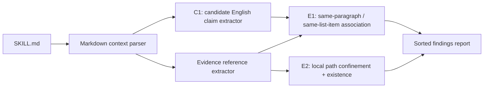

# skill-evidence-lint

**A static lint for `SKILL.md` that checks whether detectable English effect claims have a recognizable evidence reference in the same Markdown paragraph or enclosing list item.**

[](https://github.com/xiaohei52056/skill-evidence-lint/actions/workflows/tests.yml)
[](LICENSE)
[](pyproject.toml)
[](https://github.com/xiaohei52056/skill-evidence-lint/releases/tag/v0.1.0)

Other tools can test how a Skill behaves, validate how it is structured, or measure whether it improves task performance. **skill-evidence-lint addresses a different, narrower question:** when a Skill's `SKILL.md` says something like *"reduces processing time by 40%"* or *"2x faster execution"*, does the surrounding Markdown actually point at evidence — and is that evidence path still inside the Skill folder?

It is a read-only static analyzer. It does not run your Skill, does not fetch URLs, and does not judge whether a claim is true.

---

## The problem

AI Skill manifests often mix procedural instructions with quantified effect claims:

> "Reduces processing time by 40%."
> "Achieves 92% accuracy."
> "Zero downtime."

These statements look concrete and measurable. But a reader of the file usually cannot tell, without careful inspection:

- whether a supporting reference exists at all;
- whether that reference is actually adjacent to the claim, or sitting in an unrelated paragraph three sections later;
- whether a local file the claim points at still ships with the Skill.

General Markdown linters do not model the "claim → adjacent evidence" relationship. Runtime tests measure behavior, but they do not automatically prove that every effect sentence in `SKILL.md` has a clearly associated evidence reference. `skill-evidence-lint` fills this documentation-level gap with a lightweight, offline check.

## Where it fits in the Agent Skills toolchain

Different tools answer different questions. This project is not a replacement for any of them.

| Category | Primary question | Typical approach | Examples |
|---|---|---|---|
| Skill specification / quality linters | Is the Skill structurally valid and well-formed? | Static rules, metadata and quality checks | [skill-tools](https://github.com/skill-tools/skill-tools), [skills_lint.dart](https://github.com/google/skills_lint.dart) |
| Runtime Skill testing frameworks | Does the Skill produce the expected behavior or artifacts? | Test cases, Agent execution, assertions | [skilltest](https://github.com/JiyangZhang/skilltest), [SkillProof](https://github.com/Dafenxz0/skillproof) |
| Skill performance evaluation | Does the Skill improve task outcomes, and at what cost? | Controlled comparisons, benchmarks | (your evaluation harness) |
| **skill-evidence-lint** | **Do detectable effect claims have recognizable evidence references in their local Markdown context?** | **Static claim detection, same-paragraph / same-list-item association, local path checks** | this repo |

A reasonable layered workflow — optional, not mandatory — is:

1. Validate the Skill's structure with an appropriate specification linter.
2. Run **skill-evidence-lint** to inspect effect-claim evidence-reference coverage.
3. Use runtime tests and evaluation tools to measure actual behavior and outcomes.

## What it checks

| Rule | Target | Catches | Known limits |
|---|---|---|---|
| **C1** | Candidate English effect claims | Four conservative quantified patterns: `Q-VERB-BY` ("reduces … by 40%"), `Q-ACHIEVES-NUM` ("achieves 92%"), `Q-NUM-COMP` ("2x faster"), `Q-ZERO` ("zero downtime", "near-zero latency") | English only; paragraphs only; code blocks, headings, frontmatter excluded; qualitative claims and passive phrasing without the target verbs are not matched |
| **E1** | Evidence association | A candidate claim with **no local path or URL reference in the same paragraph or enclosing list item** | Adjacent paragraphs, headings, and a shared "Evidence" section never count; backtick commands do not count as evidence |
| **E2** | Local evidence paths | A referenced local file that is missing, escapes the Skill root, or cannot be resolved | URLs are never fetched; files are never opened; only path metadata (`stat`) is used |

## How it works



Result semantics:

- **C1** identifies *candidate* claims. It does not establish that the claims are true.
- **E1** says: no recognized URL or local path was associated with this candidate in the permitted context.
- **E2** says: a local reference is missing, escapes the Skill root, or cannot be resolved.
- A URL is never fetched; its reachability or content is not verified.
- A recognized reference is not proof of evidential sufficiency.

## Before / after example

A claim with no recognizable reference in its own paragraph:

```markdown
## Performance

Reduces processing time by 40%.
```

If C1 matches the sentence, E1 will report that no local path or URL appears in the same paragraph or enclosing list item.

Add the reference in the *same* paragraph:

```markdown
## Performance

Reduces processing time by 40%, according to [the benchmark report](references/benchmark.md).
```

The in-paragraph link clears E1. E2 can still fire if `references/benchmark.md` is missing or escapes the Skill root — and a URL in that slot would clear E1 without being fetched or verified.

## Why use it

- **Focused signal.** A small, explicit set of English quantified patterns, rather than an open-ended semantic guesser.
- **Local-context association.** A reference must sit in the same paragraph or list item. A neighboring paragraph or a global "Evidence" section does not count.
- **Static and lightweight.** Pure Markdown + path metadata. No Agent launch, no Skill execution, no evidence-script run.
- **Offline by design.** No URL fetching, no network calls.
- **Path confinement.** Every local reference is resolved against the directory containing `SKILL.md`; `..` segments and symlink escapes are reported, not followed.
- **Predictable CI behavior.** E1/E2 findings are reported but do not fail the command in v0.1.0. Invalid input and unexpected internal errors use distinct exit codes.
- **Transparent limitations.** The tool never claims that a reference proves the associated statement.

## Quick start

Requires Python 3.11 or newer. **The package is not yet on PyPI.** Install from source:

```bash
git clone https://github.com/xiaohei52056/skill-evidence-lint.git
cd skill-evidence-lint
python -m pip install .
```

Check a Skill directory (looks for `SKILL.md` inside):

```bash
skill-evidence-lint path/to/skill
```

Or point directly at a file named `SKILL.md`:

```bash
skill-evidence-lint path/to/skill/SKILL.md
```

A minimal example:

```
example-skill/
├── SKILL.md
└── results.md
```

```markdown
# My Skill

Our optimizer reduces build time by 40%, see results.md.

The pipeline cuts CI cost by 2x.
```

Actual output on v0.1.0:

```
skill-evidence-lint
  SKILL.md : example-skill/SKILL.md
  Claims   : 2
  Refs     : 1
  Findings : 1
  E1 (line 5): No local-path or URL evidence reference found in the same paragraph or the enclosing list item. This is a coverage observation, not a judgment that the claim is false or that evidence is invalid.
Summary: E1=1 E2=0. Findings are reports, not failures.
```

Exit code is **0** even with one E1 finding. The first claim is paired with `results.md` in its own paragraph; the second claim has no reference in its paragraph, so E1 flags it.

## Reading the report

- **Claims** — candidate effect claims C1 matched. Not a count of all real effect claims in the document.
- **Refs** — recognizable references (local paths, URLs, backtick commands). Backtick commands are recorded but do **not** clear E1.
- **Findings** — rule reports. Not a count of false claims.
- **E1 (line N)** — candidate claim at line N has no qualifying reference in its own paragraph or list item.
- **E2 (line N)** — a local path referenced at line N is missing or escapes the Skill root.
- **Summary: E1=… E2=…** — findings by rule.

### Exit codes

| Code | Meaning |
|---|---|
| `0` | Check completed normally. E1/E2 findings do **not** change this. |
| `2` | User input error: bad path, missing `SKILL.md`, file not named `SKILL.md`. |
| `3` | Unexpected internal error (see `internal error:` on stderr). |

## Safety, trust boundaries, and non-goals

`skill-evidence-lint` deliberately does **not**:

- prove that an effect claim is true;
- verify that a referenced document actually supports the claim;
- fetch URLs or check their reachability;
- execute the Skill, backtick commands, or evidence scripts;
- recognize qualitative claims, Chinese text, headings, code blocks, or frontmatter;
- guarantee that it finds every under-referenced claim.

Not implemented in v0.1: E3–E7, auto-fix, LLM-as-judge, URL reachability, JSON output, multi-file batch checks, and a reusable GitHub Action.

## Evaluation

Numbers come from [`docs/c1-evaluation.md`](docs/c1-evaluation.md) and [`tests/fixtures/c1_eval/manifest.json`](tests/fixtures/c1_eval/manifest.json).

- **Synthetic fixture (project-owned):** 13 hand-written in-scope spans across all four C1 patterns. **C1 caught 13/13.**
- **Real documents:** 17 redistributable public `SKILL.md` files — 13 Apache-2.0 from `anthropics/skills` at a pinned commit, 4 MIT from `obra/superpowers` at a pinned commit. C1 produced **0 candidates**, and manual review found **0 in-scope positive spans** in that set.
- **Real-world precision and recall are not computable** from this sample. The corpus is heavily procedural; "0 candidates, 0 positives" is an observation about this particular set, not a real-world accuracy rate. Five additional Anthropic files were examined but excluded because their per-directory LICENSE forbids redistribution.

CI runs on Ubuntu (Python 3.11, 3.12), macOS (3.12), and Windows (3.12): **113 passed, Ruff clean on every job.** This includes the two symlink-based E2 checks that are skipped on Windows developer machines lacking the symlink-privilege token.

## Development

```bash
python -m pip install -e ".[dev]"
py -3.12 -m pytest -ra
py -3.12 -m ruff check .
```

The offline evaluation runner is dev-only and not imported by pytest:

```bash
py -3.12 scripts/run_c1_eval.py
```

Issues and Pull Requests are welcome. There is no formal code of conduct yet.

## License

MIT. See [LICENSE](LICENSE). Third-party evaluation fixtures carry their own licenses (Apache-2.0 for `anthropics/skills`, MIT for `obra/superpowers`); see `tests/fixtures/c1_eval/real/` and `manifest.json` for provenance.
